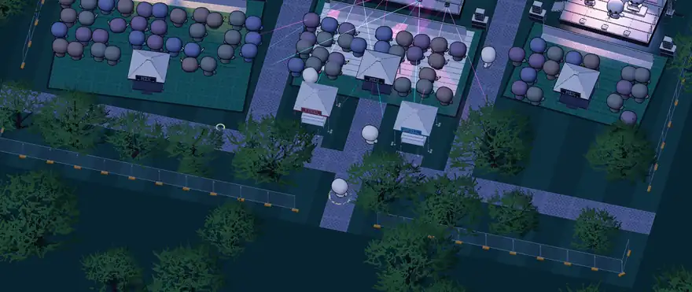
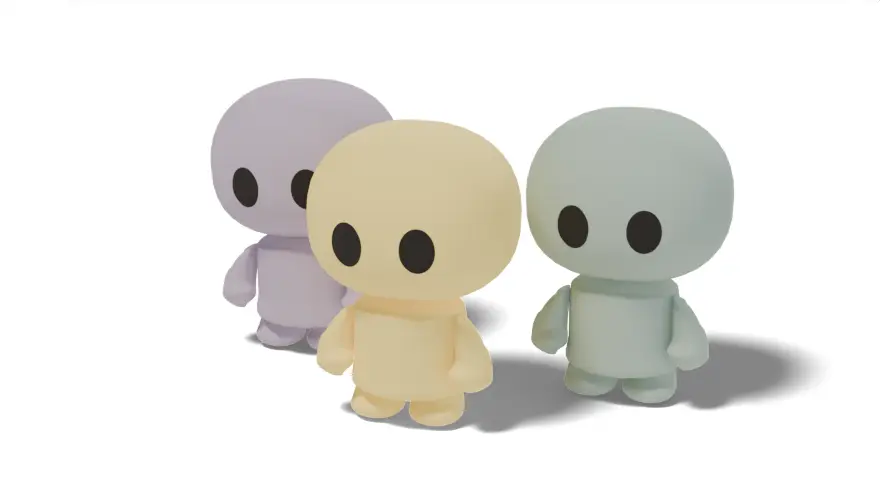
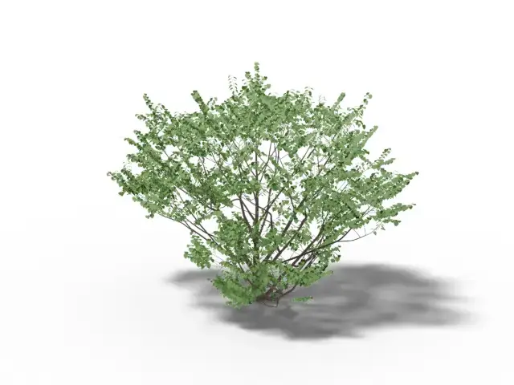
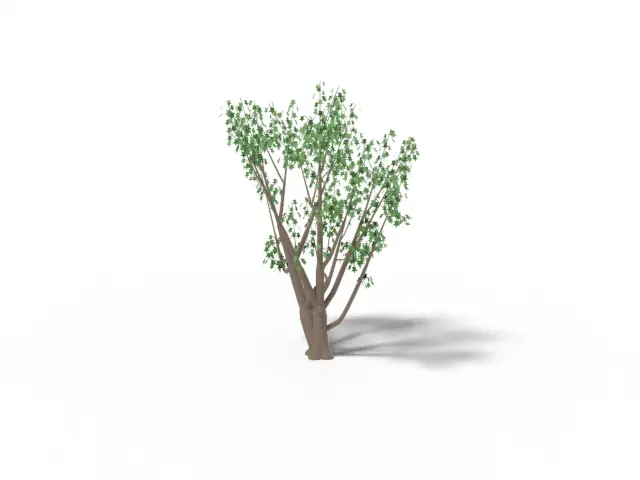

<p align="center">
  
</p>

# model-kit

Build 3D models for games in Blender, and check them against how real things are made.

An AI coding tool can write a Blender script that builds a model. It cannot see that a bolt floats
off its plate, that a knee bends through a thigh, or that a branch grows through its neighbour.
model-kit gives the tool finished reference pieces to start from and 37 checks to finish with.
Each check rests on a cited source: a standard, a paper, a measured tree. A model is done when the
gate passes and its sheet looks right beside its reference.

<sub>Above: a made-up festival built from kit pieces. The scene itself is not in this repository.</sub>

## What it makes

<p align="center">
  <picture><source media="(prefers-color-scheme: dark)" srcset="media/guys-dark.webp"></picture>
</p>

**The guys.** One rigged chibi: a bone chain, a skin and an idle clip. The checks take every joint
to the ends of its cited range of motion and fail any pose where the body passes through itself.

<p align="center">
  <picture><source media="(prefers-color-scheme: dark)" srcset="media/redbud-dark.webp"></picture>
  <picture><source media="(prefers-color-scheme: dark)" srcset="media/sweetgum-dark.webp"></picture>
</p>

**Trees are grown, not modelled.** Each year a tree adds buds, and each bud wakes or sleeps by its
light. Every number in a species file names its source, and a grown tree is measured against four
lidar-scanned trees. A redbud and a young sweetgum, from one grower.

## Use it

You need [uv](https://docs.astral.sh/uv/) and Blender. Run this in your project folder:

```bash
uvx --from git+https://github.com/bnhoang2k/model-kit@v0.1.0 model-kit init
```

It installs model-kit for your project and adds one line to your `CLAUDE.md` (and to `AGENTS.md`,
if your project has one) that sends your coding agent to the kit's steps. Running it again is safe.
Set `MODEL_KIT_BLENDER` to your Blender executable.

Then ask for models as usual. The agent follows [AGENTS.md](AGENTS.md): it picks the nearest
reference piece, states how close the model is seen from, builds, and runs the gate until it passes.

## Check a model yourself

```bash
model-kit gate path/to/scene
model-kit sheet lamp.pack.json --piece Lamp --style style.json
```

The gate prints `passed`, `partial` or `failed: n`, and a line for each finding. The sheet draws
the piece in five views beside its reference piece, at one scale, with a 1 m post.

## More

- [REFERENCE.md](REFERENCE.md): every command, check and manifest field.
- [bars/INDEX.md](bars/INDEX.md): the reference pieces and what each one fits.
- [tools/showcase.py](tools/showcase.py): renders the loops above from the reference pieces.

MIT licence. The four measured trees in `test/fixtures/qsm/` are CC-BY 4.0 (Demol, Gielen and
Verbeeck 2021); see their [CREDITS.md](test/fixtures/qsm/CREDITS.md).
